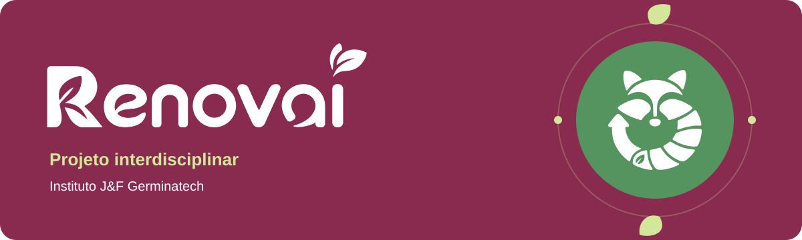

<div align="center">
  <a id="projeto-interdisciplinar"></a>
  <h1>Renovai</h1>
  <p><strong>Instituto J&amp;F Germinatech</strong></p>
  <p>Backend, frontend, dados, mobile, inteligência artificial e UX.<br>Uma plataforma que conecta as disciplinas do 1º e 2º ano.</p>
  <p>
    <a href="#repositorios"><strong>Explore os repositórios</strong></a> &nbsp; · &nbsp;
    <a href="#primeiros-passos">Comece por aqui</a> &nbsp; · &nbsp;
    <a href="#integrantes">Conheça a equipe</a>
  </p>
  <br>
  <p>
    
    
    
    
    
    
    
  </p>
</div>

<p align="center">
  
</p>

---

## Explore o projeto

| Conheça a solução | Prepare seu ambiente | Contribua com a equipe |
| :--- | :--- | :--- |
| [Sobre o projeto](#sobre-o-projeto) | [Primeiros passos](#primeiros-passos) | [Padrão de branches](#padrao-de-branches) |
| [Arquitetura geral](#arquitetura-geral) | [Variáveis de ambiente](#variaveis-de-ambiente) | [Convenções de commit](#convencoes-de-commit) |
| [Repositórios](#repositorios) | [Tecnologias](#tecnologias) | [Fluxo de trabalho](#fluxo-de-trabalho) |
| [Integrantes](#integrantes) | [Infraestrutura e deploy](#infraestrutura-e-deploy) | [Pull requests](#pull-requests) · [Code review](#code-review) |
| [Licença](#licenca) | [Documentação](#documentacao) | [Testes](#testes) |

---
<a id="sobre-o-projeto"></a>

## Sobre o projeto

Descreva aqui o problema que o projeto resolve, o publico-alvo e o valor entregue pela solucao. Esta secao deve ser preenchida pelo grupo com base na proposta definida em UX e Metodologia de Projetos.

Exemplos de informacoes a incluir:

- Qual problema social, ambiental ou de negocio o projeto aborda
- Quem sao os usuarios da solucao
- Qual o impacto esperado

---

<a id="arquitetura-geral"></a>

## Arquitetura geral

O sistema e composto por camadas independentes que se comunicam por meio de APIs REST e filas de mensagens. A comunicacao entre o banco de dados do 1o ano e o do 2o ano e realizada via RPA, conforme definido na disciplina de Modelagem de Dados.

```
[App Mobile]        [Web App - React/TS]     [Landing Page]
      |                      |                      |
      +----------+-----------+                      |
                 |                                  |
         [API REST - Spring MVC]                    |
                 |                                  |
    +------------+------------+                     |
    |            |            |                     |
[PostgreSQL]  [MongoDB]    [Redis]            [GitHub Pages]
  (1o Ano)   (Conversacional) (Filas/Ranking)
    |
   RPA
    |
[PostgreSQL Normalizado - 2o Ano]
    |
[Data Mart / Views Analiticas]
    |
[Dashboard BI] + [Pipeline Databricks]
```

---

<a id="repositorios"></a>

## Repositórios

A organizacao e dividida por camada de responsabilidade. Cada repositorio possui seu proprio `README.md` com instrucoes especificas.

### 1º ano

| Repositorio | Disciplina | Descricao | Tecnologia |
|---|---|---|---|
| `backend-java` | POO / Desenvolvimento 1 | CRUD administrativo com Servlets e JDBC | Java, PostgreSQL |
| `frontend-web` | Desenvolvimento 1 | Landing page e telas CRUD | HTML, CSS, JavaScript |
| `database-1ano` | Banco de Dados 1 | Scripts SQL, modelo conceitual e logico | PostgreSQL |

### 2º ano

| Repositorio | Disciplina | Descricao | Tecnologia |
|---|---|---|---|
| `api-rest` | Desenvolvimento 2 | API REST principal com Spring MVC e JPA | Java, Spring Boot, PostgreSQL |
| `frontend-react` | Desenvolvimento de Aplicacoes Dinamicas | SPA com React, TypeScript e Vite | React, TypeScript, Vite |
| `mobile-app` | Desenvolvimento de Aplicativos Moveis | App mobile com chatbot e hardware | (definir: Flutter / React Native) |
| `ai-service` | Inteligencia Artificial | Sistema multiagente com FastAPI | Python, FastAPI, Langchain, Langgraph |
| `database-2ano` | Modelagem de Dados | Banco normalizado, ETL, procedures e views | PostgreSQL |
| `bi-dashboard` | Business Intelligence | Dashboard e pipeline de dados | Databricks, (ferramenta BI) |
| `ux-design` | UX / Experiencia do Usuario | Prototipos, pesquisas e design system | Figma |

---

<a id="tecnologias"></a>

## Tecnologias

### Backend

- Java 17 com Servlets e JDBC (1o ano - POO)
- Java 17 com Spring Boot, Spring MVC, Spring Data JPA, Spring Security (2o ano - Desenvolvimento 2)
- Python 3.11 com FastAPI ou Flask (2o ano - IA)
- Langchain e Langgraph para orquestracao de agentes (2o ano - IA)

### Frontend

- HTML5, CSS3, JavaScript puro (1o ano - Desenvolvimento 1)
- React 18 com TypeScript, Vite, React Router (2o ano - Desenvolvimento de Aplicacoes Dinamicas)

### Mobile

- A definir pelo grupo (Flutter ou React Native)
- Firebase ou SQLite para persistencia local

### Banco de Dados

- PostgreSQL (banco relacional - 1o e 2o ano)
- MongoDB (interacao conversacional - 2o ano)
- Redis (filas de processamento e ranking em tempo real - 2o ano)
- Neo4J (modelagem em grafo - extra 2o ano)

### Dados e BI

- Databricks para pipeline ETL e jobs
- Star Schema / Snowflake para Data Mart
- Ferramenta de BI a definir (Power BI, Metabase, Tableau etc.)

### DevOps e Infraestrutura

- Docker e Docker Compose para conteinerizacao
- Kubernetes para orquestracao
- GitHub Actions ou Jenkins para pipeline de CI/CD
- Cloud a definir (AWS, GCP ou Azure)
- GitHub Pages ou Vercel para hospedagem do frontend estatico

---

<a id="primeiros-passos"></a>

## Primeiros passos

### Pre-requisitos

- Git 2.40 ou superior
- Node.js 20 LTS
- Java 17 (JDK)
- Python 3.11 ou superior
- Docker e Docker Compose
- IntelliJ IDEA (para projetos Java)
- Acesso as variaveis de ambiente (solicitar ao responsavel pelo repositorio)

### Clonando um repositorio

```bash
git clone https://github.com/nome-da-organizacao/nome-do-repositorio.git
cd nome-do-repositorio
```

Consulte o `README.md` de cada repositorio para instrucoes especificas de instalacao, configuracao e execucao local.

---

<a id="variaveis-de-ambiente"></a>

## Variáveis de ambiente

Nenhuma credencial, chave de API, senha ou segredo deve ser versionada. O arquivo `.env` real deve constar no `.gitignore`.

Cada repositorio deve conter um arquivo `.env.example` com os nomes das variaveis e valores de exemplo. As variaveis minimas esperadas sao:

```env
# Banco de Dados PostgreSQL
DB_HOST=localhost
DB_PORT=5432
DB_NAME=nome_do_banco
DB_USER=usuario
DB_PASSWORD=senha

# MongoDB
MONGO_URI=mongodb://localhost:27017/nome_do_banco

# Redis
REDIS_HOST=localhost
REDIS_PORT=6379

# APIs de IA (nao versionar chaves reais)
OPENAI_API_KEY=sua_chave_aqui
GEMINI_API_KEY=sua_chave_aqui
```

A escola nao arca com despesas de APIs de IA generativa. Cada integrante e responsavel por gerenciar suas proprias chaves de acesso.

---

<a id="padrao-de-branches"></a>

## Padrão de branches

Todos os repositorios seguem o mesmo modelo de ramificacao baseado em Git Flow adaptado.

### Branches permanentes

| Branch | Descricao |
|---|---|
| `main` | Codigo em producao. Protegida contra push direto. |
| `develop` | Branch de integracao. Base para novas features. |

### Branches temporarias

Formato: `tipo/descricao-curta-com-hifens`

| Tipo | Quando usar | Exemplo |
|---|---|---|
| `feature/` | Nova funcionalidade | `feature/tela-cadastro-usuario` |
| `fix/` | Correcao de bug em desenvolvimento | `fix/calculo-ranking-redis` |
| `hotfix/` | Correcao urgente em producao | `hotfix/falha-autenticacao` |
| `refactor/` | Refatoracao sem alteracao de comportamento | `refactor/servico-agente-rag` |
| `chore/` | Configuracoes, dependencias, CI/CD | `chore/configurar-docker-compose` |
| `docs/` | Documentacao | `docs/readme-api-rest` |
| `test/` | Adicao ou correcao de testes | `test/cobertura-crud-produto` |
| `data/` | Pipelines, ETL, notebooks, schemas | `data/pipeline-etl-vendas` |

### Regras

- Nenhum commit direto em `main` ou `develop`.
- Nomes de branches em letras minusculas, sem acentos.
- Branches excluidas apos o merge do Pull Request.
- Branches `hotfix/` partem de `main` e devem ser mescladas em `main` e em `develop`.

---

<a id="convencoes-de-commit"></a>

## Convenções de commit

Esta organizacao adota o padrao **Conventional Commits** (https://www.conventionalcommits.org).

A disciplina de **Desenvolvimento de Aplicacoes Dinamicas** exige minimo de 20 commits no padrao Conventional Commits, cobrindo ao menos 4 semanas de desenvolvimento. Commits genericos serao recusados na avaliacao.

### Estrutura

```
<tipo>(<escopo>): <descricao curta>

[corpo opcional]

[rodape opcional]
```

### Tipos de commit

| Tipo | Quando usar |
|---|---|
| `feat` | Nova funcionalidade |
| `fix` | Correcao de bug |
| `refactor` | Refatoracao sem alteracao de comportamento |
| `perf` | Melhoria de performance |
| `test` | Adicao ou correcao de testes |
| `docs` | Alteracao de documentacao |
| `style` | Formatacao, espacos, ponto e virgula |
| `chore` | Dependencias, configuracoes, scripts |
| `ci` | Arquivos de CI/CD |
| `revert` | Reversao de commit anterior |
| `data` | Pipelines, ETL, notebooks, modelos de dados |

### Escopo por repositorio

| Repositorio | Exemplos de escopo |
|---|---|
| `backend-java` | `servlet`, `dao`, `model`, `jdbc`, `crud` |
| `api-rest` | `auth`, `user`, `product`, `exception`, `jpa` |
| `frontend-web` | `landing`, `form`, `crud`, `style` |
| `frontend-react` | `router`, `components`, `services`, `hooks`, `types` |
| `mobile-app` | `auth`, `camera`, `chatbot`, `gps`, `firebase` |
| `ai-service` | `agent`, `rag`, `guardrail`, `memory`, `graph` |
| `database-1ano` | `schema`, `script`, `dataload`, `model` |
| `database-2ano` | `etl`, `procedure`, `trigger`, `index`, `view` |
| `bi-dashboard` | `pipeline`, `kpi`, `dashboard`, `job` |

### Descricao curta

- Imperativo no presente: "adiciona", "corrige", "remove".
- Maximo de 72 caracteres.
- Sem letra maiuscula no inicio.
- Sem ponto final.

### Corpo

Use quando a mudanca precisa de contexto. Explique o que e por que, nao como. Separe do cabecalho com uma linha em branco.

### Rodape

```
Closes #42
BREAKING CHANGE: endpoint /users agora requer autenticacao JWT
```

### Exemplos validos

```
feat(crud): adiciona tela de cadastro de produto com validacao de campos
```

```
fix(agent): corrige contexto perdido entre sessoes no agente de RAG

O historico de mensagens nao estava sendo persistido corretamente
no MongoDB entre requisicoes distintas do mesmo usuario.

Closes #88
```

```
data(etl): implementa CTE para transformacao de dados de vendas por regiao
```

```
chore: adiciona docker-compose para banco de dados local
```

```
test(dao): adiciona testes unitarios para UsuarioDAO
```

### Exemplos invalidos

```
# Generico
fix: correcao

# Nao usa imperativo
feat: adicionei o login

# Mistura multiplas alteracoes
feat: adiciona login, corrige bug no header e atualiza dependencias
```

### Commits atomicos

Cada commit deve representar uma unica alteracao logica. Evite commits que misturam funcionalidades, correcoes e refatoracoes. Prefira commits menores e mais frequentes.

---

<a id="fluxo-de-trabalho"></a>

## Fluxo de trabalho

1. Atualize `develop` antes de comecar qualquer trabalho.

```bash
git checkout develop
git pull origin develop
```

2. Crie a branch seguindo o padrao definido.

```bash
git checkout -b feature/nome-da-funcionalidade
```

3. Desenvolva com commits atomicos e mensagens no padrao Conventional Commits.

4. Mantenha a branch atualizada com `develop` via rebase.

```bash
git fetch origin
git rebase origin/develop
```

5. Abra um Pull Request para `develop` ao concluir a implementacao.

6. Apos aprovacao e merge, exclua a branch remota.

Para `hotfix/`: a branch parte de `main`, o PR e aberto para `main` e, apos o merge, um segundo PR deve ser aberto para `develop`.

---

<a id="pull-requests"></a>

## Pull requests

### Antes de abrir

- [ ] O codigo compila e executa sem erros localmente.
- [ ] Os testes existentes passam.
- [ ] Novos testes foram adicionados para cobrir a mudanca, quando aplicavel.
- [ ] A branch esta atualizada com `develop` via rebase.
- [ ] O `.env.example` foi atualizado caso novas variaveis tenham sido adicionadas.
- [ ] A documentacao relevante foi atualizada.

### Titulo

Mesmo formato do Conventional Commits:

```
feat(auth): adiciona autenticacao JWT na API REST
```

### Descricao

A descricao deve conter:

- O que foi feito: resumo das alteracoes.
- Por que foi feito: contexto e motivacao.
- Como testar: passos para validar o comportamento esperado.
- Issue relacionada: `Closes #numero` ou `Ref #numero`.
- Disciplina relacionada (quando aplicavel): ex. "Requisito M2 - Desenvolvimento 2".

### Regras

- Minimo de uma aprovacao para fazer o merge.
- O autor nao pode aprovar o proprio PR.
- PRs com conflitos devem ser resolvidos antes da aprovacao.
- PRs grandes dificultam o review. Prefira entregas menores e incrementais.

---

<a id="code-review"></a>

## Code review

### Para quem revisa

- Avalie logica, legibilidade, seguranca e aderencia aos padroes do projeto.
- Seja objetivo e construtivo. Use prefixos para classificar o comentario: `BLOCKER`, `SUGGESTION` ou `NIT`.
- Aprove somente quando estiver confortavel com o codigo.

### Para quem recebe

- Responda todos os comentarios antes de solicitar nova revisao.
- Nao faca force-push em uma branch com revisao em andamento sem avisar o revisor.

---

<a id="testes"></a>

## Testes

| Repositorio | Cobertura minima | Tipos esperados |
|---|---|---|
| `backend-java` | 70% | Unitarios (DAO, Model), integracao (Servlet) |
| `api-rest` | 80% | Unitarios, integracao, contrato (Swagger) |
| `frontend-react` | 70% | Unitarios (componentes), acessibilidade |
| `ai-service` | 60% | Unitarios por agente, testes de guardrail |
| `database-2ano` | N/A | Validacao de procedures, triggers e funcoes |

- Testes devem ser executados localmente antes de abrir o PR.
- A pipeline de CI executa os testes automaticamente em todo PR.
- PRs com falha nos testes nao serao aprovados.

---

<a id="infraestrutura-e-deploy"></a>

## Infraestrutura e deploy

### Conteinerizacao

Todos os servicos devem ter `Dockerfile` e estar configurados no `docker-compose.yml` para execucao local.

```bash
docker-compose up -d
```

### CI/CD

A pipeline de implantacao e configurada via GitHub Actions (ou Jenkins). As etapas esperadas sao: lint, testes, build e deploy automatico para o ambiente de nuvem.

O arquivo de pipeline deve estar em `.github/workflows/` ou na raiz do repositorio no caso do Jenkins.

### Hospedagem

| Camada | Ambiente | Plataforma |
|---|---|---|
| Frontend estatico (1o ano) | Producao | GitHub Pages |
| Frontend React (2o ano) | Producao | Vercel ou GitHub Pages |
| API REST | Producao | Cloud (AWS / GCP / Azure) |
| Servico de IA | Producao | Cloud (AWS / GCP / Azure) |
| Banco de Dados | Producao | Cloud gerenciado |

O link do site publicado deve estar registrado neste README e no documento de entregas de cada disciplina.

---

<a id="documentacao"></a>

## Documentação

Cada repositorio deve manter sua documentacao atualizada:

- `README.md` com instrucoes de instalacao, execucao e variaveis de ambiente.
- `docs/` com documentos de requisitos, diagramas e decisoes tecnicas.
- Endpoints REST documentados via Swagger (obrigatorio para `api-rest` - requisito extra de Desenvolvimento 2).
- Modelos conceitual e logico do banco de dados em `database-1ano/docs/`.
- Scripts de ETL e views analiticas documentados em `database-2ano/docs/`.
- Memorial descritivo do uso de IA em `docs/ia-memorial.md` (requisito de Introducao a IA).
- Documento de dinamica de trabalho da equipe em `docs/equipe.md` (requisito de Engenharia de Software - M5).

### Documento de Entregas

Cada disciplina que exige documento de entregas (Desenvolvimento 1, Sistemas Operacionais, Desenvolvimento de Operacoes Ageis) deve ter um arquivo dedicado em `docs/entregas/` descrevendo cada requisito, seu status e o link direto para o artefato correspondente no repositorio.

---

## Integrantes

### 1º ano

<table>
  <tr>
    <td align="center">
      <a href="https://github.com/paolapietropoli">
        <br>
        <sub><b>Paola Pietropoli</b></sub>
      </a>
    </td>
    <td align="center">
      <a href="https://github.com/lukastheodoro07">
        <br>
        <sub><b>Lukas Fernandes</b></sub>
      </a>
    </td>
    <td align="center">
      <a href="https://github.com/garcialuluiza04-design">
        <br>
        <sub><b>Luiza Garcia</b></sub>
      </a>
    </td>
    <td align="center">
      <a href="https://github.com/sobraldavi-lgtm">
        <br>
        <sub><b>Davi Sobral</b></sub>
      </a>
    </td>
    <td align="center">
      <a href="https://github.com/joelgg4610">
        <br>
        <sub><b>Joel Gracek</b></sub>
      </a>
    </td>
  </tr>
</table>

### 2º ano

<table>
  <tr>
    <td align="center">
      <a href="https://github.com/Caio-cyber6">
        <br>
        <sub><b>Caio Franca</b></sub>
      </a>
    </td>
    <td align="center">
      <a href="https://github.com/Rafael-Takematsu">
        <br>
        <sub><b>Rafael Takematsu</b></sub>
      </a>
    </td>
    <td align="center">
      <a href="https://github.com/iago511">
        <br>
        <sub><b>Iago Diniz</b></sub>
      </a>
    </td>
    <td align="center">
      <a href="https://github.com/GabrielAndozia">
        <br>
        <sub><b>Gabriel Masagao</b></sub>
      </a>
    </td>
    <td align="center">
      <a href="https://github.com/Krs95xz">
        <br>
        <sub><b>Kaua Sales</b></sub>
      </a>
    </td>
    <td align="center">
      <a href="https://github.com/GuiSPCN">
        <br>
        <sub><b>Guilherme Norcia</b></sub>
      </a>
    </td>
  </tr>
</table>

---

<a id="licenca"></a>

## Licença

Projeto academico de uso interno. Todos os direitos reservados ao Instituto J&F Germinatech e aos integrantes do grupo. Uso restrito ao contexto do projeto interdisciplinar.


---

<p align="center"><sub>Renovai · Instituto J&amp;F Germinatech</sub><br><a href="#projeto-interdisciplinar">Voltar ao início</a></p>
